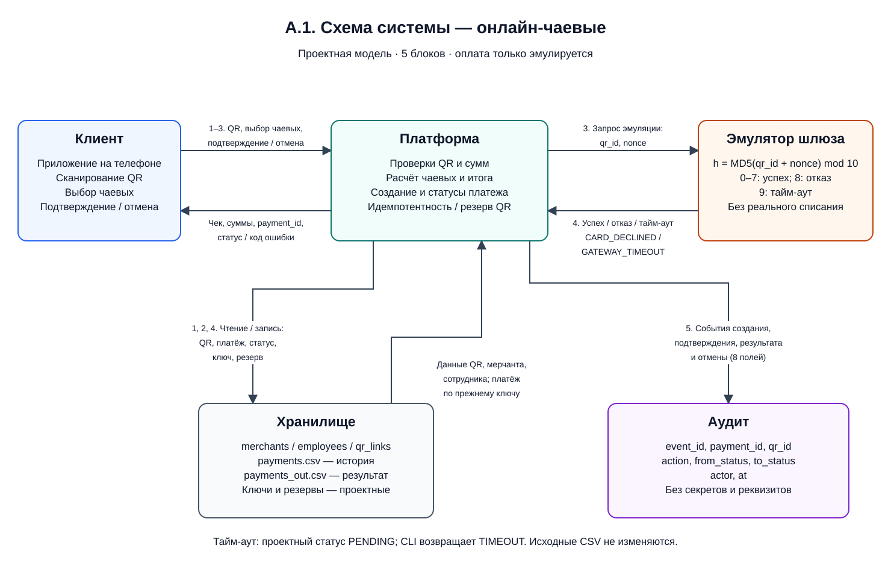
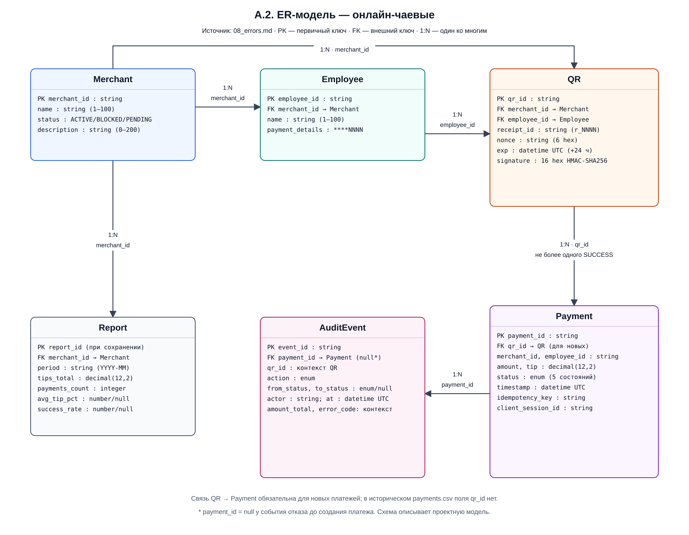
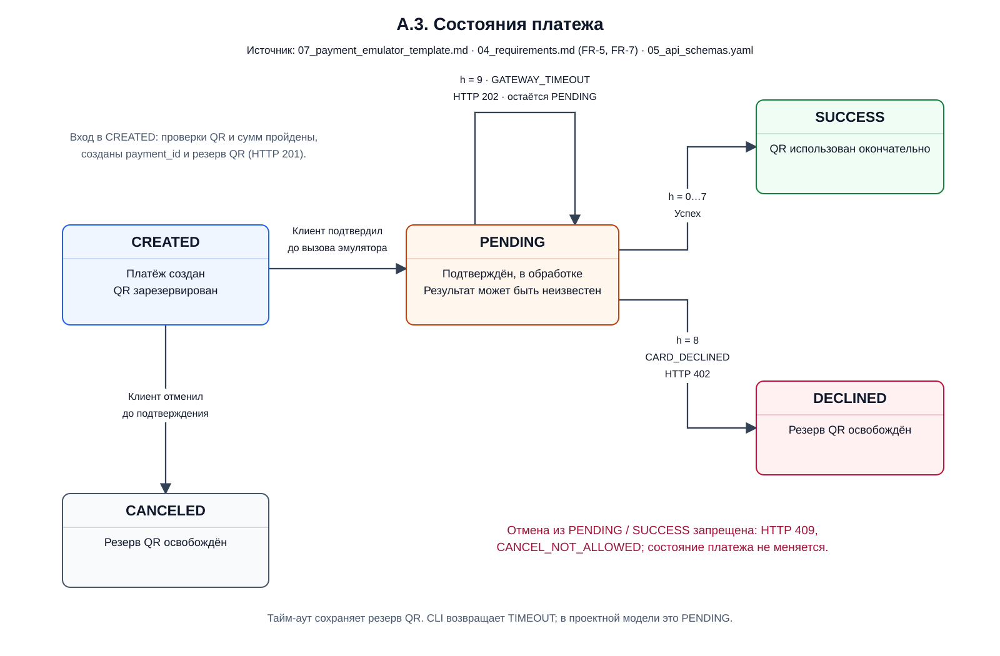
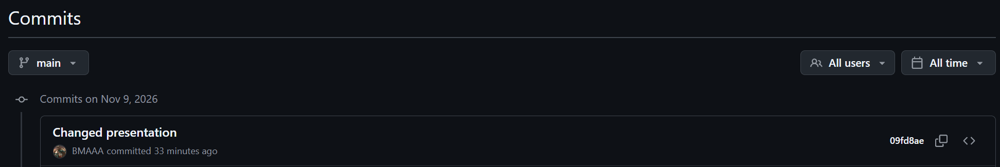
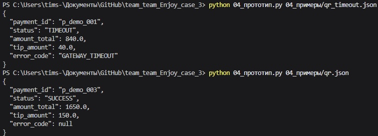
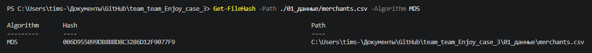

# Приложение к презентации — кейс 3 «Онлайн-чаевые»

## Как заполнять

Приложение — документ-доказательство: схемы, таблицы, тесты, журнал ИИ,
матрица вклада. Жюри читает его до защиты. Объём: 10–15 страниц.
Заполни разделы A–E. В таблицах даны 1–2 примера, остальное — «?».

## A. Диаграммы

### A.1. Схема системы (обязательно)

|Блок|Что это|Что передаёт|
|-|-|-|
|Клиент|приложение на телефоне|QR-код, выбор чаевых|
|Платформа|сервис чаевых|Принимает QR, выбор чаевых, подтверждение или отмену; проверяет QR и суммы, создаёт платёж; передаёт запрос эмулятору, данные в хранилище и события в аудит; возвращает клиенту данные чека, суммы и результат|
|Эмулятор шлюза|модуль имитации оплаты без реального списания|Получает `qr_id` и `nonce`; вычисляет `h = int(MD5(UTF8(qr_id + nonce)).hexdigest(), 16) % 10`; возвращает успех (0–7), отказ `CARD_DECLINED` (8) или тайм-аут `GATEWAY_TIMEOUT` (9)|
|Хранилище|CSV с мерчантами, сотрудниками, QR и историей платежей; выходной `payments_out.csv`; проектное служебное хранение ключей идемпотентности и резервов QR|Возвращает платформе данные мерчанта, сотрудника, QR и существующего платежа; принимает записи и статусы новых платежей, ключи идемпотентности и состояние резерва QR; исходные CSV не изменяются|
|Аудит|журнал событий действий с платежом по `11_ИБ.md`|Получает от платформы `event_id`, `payment_id`, `qr_id`, `action`, `from_status`, `to_status`, `actor`, `at`; сохраняет создание, подтверждение, результат и отмену без секретов и полных реквизитов|

**Схема системы:** [открыть и редактировать в draw.io](схемы/06_A1_схема_системы.drawio).

**Поток обработки:**

1. Клиент сканирует QR и запрашивает данные формы: `GET /api/v1/qr/{qr_id}`. Платформа получает данные из хранилища, проверяет HMAC, срок действия, одноразовость `nonce`, активность мерчанта и привязку к чеку; возвращает данные заведения, официанта, чека и варианты чаевых либо ошибку.
2. Клиент передаёт `qr_id`, `receipt_id`, `base_amount`, `tip_pct`, `idempotency_key` в `POST /api/v1/tips`. Платформа проверяет повтор запроса и суммы, рассчитывает чаевые и итог, создаёт `CREATED` и резервирует QR. Повтор с тем же ключом и параметрами возвращает существующий платёж.
3. Клиент подтверждает оплату через `POST /api/v1/payments/{id}/confirm`. Платформа переводит платёж в `PENDING`, затем вызывает эмулятор с `qr_id` и `nonce`.
4. Эмулятор возвращает результат. Платформа сохраняет `SUCCESS` или `DECLINED`; при тайм-ауте в проектной модели остаётся `PENDING`. Клиент получает `payment_id`, статус, `tip_amount`, `amount_total` и `error_code`.
5. Создание, подтверждение, результат и отмена передаются в аудит с прежним и новым статусами, исполнителем и временем. До подтверждения клиент может вызвать `POST /api/v1/payments/{id}/cancel`: `CREATED` → `CANCELED`; отмена из `PENDING` запрещена.

### A.2. ER-модель (если делаете бонус `08_ER.md`)

**Источник ER-модели:** [08_errors.md](08_errors.md) — файл, соответствующий указанному в задании `08_ER.md`.

**Диаграмма:** [редактировать в draw.io](схемы/06_A2_ER_модель.drawio).

|Сущность|PK|FK по таблицам атрибутов `08_errors.md`|
|-|-|-|
|Merchant|`merchant_id`|—|
|Employee|`employee_id`|`merchant_id` → `Merchant.merchant_id`|
|QR|`qr_id`|`merchant_id` → `Merchant.merchant_id`; `employee_id` → `Employee.employee_id`|
|Payment|`payment_id`|`qr_id` → `QR.qr_id` для новых платежей|
|Report|`report_id` при сохранении отчёта|`merchant_id` → `Merchant.merchant_id`|
|AuditEvent|`event_id`|`payment_id` → `Payment.payment_id`; может быть `null` при отказе до создания платежа|

|Связь|Тип|Обоснование по модели проекта|
|-|-|-|
|Merchant → Employee|1:N|У мерчанта несколько сотрудников; сотрудник принадлежит одному мерчанту|
|Merchant → QR|1:N|У мерчанта несколько QR для чеков|
|Employee → QR|1:N|Сотрудник указан в нескольких QR; каждый QR привязан к одному сотруднику|
|QR → Payment|1:N|После отказа или отмены возможна новая попытка; успешная оплата по QR не более одной|
|Merchant → Report|1:N|У мерчанта несколько отчётов за разные периоды|
|Payment → AuditEvent|1:N|У платежа несколько событий; отказ до создания платежа допускает отсутствие `payment_id`|

### A.3. Схема состояний платежа (обязательно)

**Основание переходов:** `07_payment_emulator_template.md` (разделы 1–3), `04_requirements.md` (FR-5, FR-7), `05_api_schemas.yaml` (перечень пяти статусов).

**Диаграмма:** [редактировать в draw.io](схемы/06_A3_состояния_платежа.drawio).

|Из состояния|В состояние|Что вызывает переход|Результат|
|-|-|-|-|
|Платёж ещё не создан|`CREATED`|QR и суммы проверены; создан уникальный `payment_id`, сохранены суммы, QR зарезервирован|HTTP 201; ожидание подтверждения клиента|
|`CREATED`|`PENDING`|Владелец сессии подтвердил платёж через `POST /api/v1/payments/{id}/confirm`|Статус изменяется до вызова эмулятора; эмулятор вызывается один раз|
|`PENDING`|`SUCCESS`|Эмулятор вернул `h` от 0 до 7 включительно|Успех; QR окончательно использован|
|`PENDING`|`DECLINED`|Эмулятор вернул `h = 8`|`CARD_DECLINED`, HTTP 402; резерв QR освобождён|
|`PENDING`|`PENDING`|Эмулятор вернул `h = 9`; результат неизвестен после тайм-аута|`GATEWAY_TIMEOUT`, HTTP 202; резерв QR сохраняется|
|`CREATED`|`CANCELED`|Клиент отменил до подтверждения через `POST /api/v1/payments/{id}/cancel`|Отмена; резерв QR освобождён|
|`PENDING` или `SUCCESS`|Состояние не меняется|Запрос отмены после подтверждения|`CANCEL_NOT_ALLOWED`, HTTP 409; переход в `CANCELED` запрещён|

## B. Таблицы

### B.1. Правила QR и платежа (из `02_правила.md`)

**Проверки QR — исходные формулировки из `02_правила.md`:**

|ID|Проверка|Действие|Код ошибки|Обоснование|
|-|-|-|-|-|
|Q-1|signature совпадает с HMAC|продолжить|—|Подтверждает целостность и подлинность полей QR; при несовпадении подписи применяется `INVALID_QR` из B.2|
|Q-2|exp >= now|продолжить|QR_EXPIRED|Ограничивает время использования QR; срок при выпуске — 24 часа|
|Q-3|`nonce` уникален среди выпущенных QR, не использован и не зарезервирован другим платежом|продолжить|`QR_USED`|Сохраняет уникальность одноразового значения, предотвращает повторную оплату и конфликт с резервом другого платежа|
|Q-4|`merchants.status` == ACTIVE|продолжить|`MERCHANT_BLOCKED`|Разрешает оплату только для активного мерчанта|
|Q-5|`receipt_id` == `QR.receipt_id`|продолжить|`RECEIPT_MISMATCH`|Связывает запрос оплаты с конкретным чеком, указанным в QR|
|Q-6|(`payments.tip` / `payments.amount`) <= 0.5|разрешить|`TIP_OUT_OF_RANGE`|Ограничивает долю чаевых относительно суммы чека, включая допустимые 50%|

**Правила платежа — исходные формулировки из `02_правила.md`:**

|ID|Условие|Действие|Код ошибки|Обоснование|
|-|-|-|-|-|
|P-1|`base_amount` ≤ 0 или > 1 000 000|отклонить|`AMOUNT_OUT_OF_RANGE`|Исключает нулевую, отрицательную и превышающую допустимый предел сумму чека|
|P-2|`idempotency_key` существует в таблице `payment`, параметры запроса совпадают|вернуть существующий платёж, HTTP 200|—|Предотвращает повторное создание платежа; при совпадении ключа и параметров возвращает существующий платёж согласно FR-6|
|P-3|(`tip` + `base_amount`) > 2000000|отклонить|`AMOUNT_OUT_OF_RANGE`|Ограничивает общую сумму чека и чаевых значением 2 000 000|
|P-4|`payments.STATUS` == `PENDING`|отклонить|`CANCEL_NOT_ALLOWED`|Запрещает отмену платежа, уже переданного на обработку; отмена разрешена только из `CREATED`|

### B.2. Матрица «ситуация → код ошибки → HTTP → retryable»

|Ситуация|Код ошибки|HTTP|retryable|
|-|-|-|-|
|Подпись QR не совпала|INVALID_QR|422|нет|
|QR истёк|QR_EXPIRED|410|да (новый QR)|
|nonce использован|QR_USED|409|нет|
|merchant BLOCKED|MERCHANT_BLOCKED|403|нет|
|tip_pct > 50|TIP_OUT_OF_RANGE|422|нет без исправления|
|amount_total > 2 000 000|AMOUNT_OUT_OF_RANGE|422|нет без исправления|
|Эмулятор вернул 8|CARD_DECLINED|402|нет для той же попытки; новая попытка возможна после отказа|
|Эмулятор вернул 9|GATEWAY_TIMEOUT|202|да, проверка статуса того же платежа|
|`base_amount` ≤ 0 или > 1 000 000|AMOUNT_OUT_OF_RANGE|422|нет без исправления|
|Тот же `idempotency_key` и те же параметры|отсутствует|200|да; возвращается существующий платёж|
|Тот же `idempotency_key`, но другое тело запроса|IDEMPOTENCY_CONFLICT|409|в проекте не указан|
|Отмена из PENDING|CANCEL_NOT_ALLOWED|409|нет|
|Отмена из SUCCESS|CANCEL_NOT_ALLOWED|409|нет|
|`receipt_id` не совпал с чеком QR|RECEIPT_MISMATCH|в проекте не указан|в проекте не указан|

### B.3. Тесты (из `03_тесты.md`)

**Результаты из `03_тесты.md` с контрольной проверкой текущего кода 08.11.2026:**

|ID|Вход|Ожидание из `03_тесты.md`|Факт|Пройден|
|-|-|-|-|-|
|T3-1|`qr_001`, `base=637.00`, `tip_pct=5`|`SUCCESS`, `amount_total=668.85`, `tip=31.85`|`tip_amount=31.85`, `amount_total=668.85`; для исходного `nonce` получено `h=9`, поэтому эмулятор возвращает `TIMEOUT`, `GATEWAY_TIMEOUT`. Суммы совпадают, ожидаемый статус — нет|Нет|
|T3-2|`qr_003`, `base=911.00`, `tip_pct=15`|`DECLINED`, `CARD_DECLINED`|Для исходного `nonce` получено `h=7`: `SUCCESS`, `error_code=null`; `tip_amount=136.65`, `amount_total=1047.65`|Нет|
|T3-3|QR с испорченной подписью|`INVALID_QR` (422) или `QR_EXPIRED` (410), платёж не создан|В изолированной проверке отрицательной ветки: `status=ERROR`, `error_code=INVALID_QR`, код завершения 2; выходной файл платежей не создан. HTTP-код консольный прототип не возвращает|Да — на уровне консольной проверки; HTTP не проверен|
|T3-4|Тот же `idempotency_key` дважды|Тот же `payment_id`, одна строка в `payments.csv`|В `03_тесты.md` зафиксированы одинаковый `payment_id` и две строки в `payments_out.csv`. В текущем коде ключ не читается; два вызова исходной `write_payment` с тем же `payment_id` создали две строки во временном файле. Исходный `payments.csv` не изменяется|Нет|
|T3-5|Создать платёж и отменить до подтверждения|`CANCELED`; отмена из `PENDING` → 409|Как указано в `03_тесты.md`, отмена не реализована. Проверка кода подтверждает отсутствие функций отмены и подтверждения и обработки состояний `CREATED`/`PENDING`; проверить ожидаемый переход и HTTP 409 на CLI невозможно|Нет — функциональность отсутствует|

## C. Журнал промптов (обязательно)

Минимум 5 строк. Формат:

|Дата|Цель|Промпт (сжато)|Результат|Проверка|Использовано|
|-|-|-|-|-|-|
|2026-11-04|Исследовательский запрос|"Как работает IndependenceKey"|текст|проверено на сайте|да|
|2026-11-04|Исследовательский запрос|"Приницп работы HMAC-SHA-256"|текст|проверено на сайте|да|
|2026-11-05|Анализ прототипа|"Проанализируй данный файл, какие функции надо завершить и что подготовить для успешного запуска"|таблица|сверил предложенное решение с действительным кодом|да|
|2026-11-05|Проверка|"Проверь файл 05_api_schemas, найди возможные ошибки и способы их устранения"|текст|проверено на сайте|да| 
|2026-11-06|Исследовательский запрос|"Объясни принцип работы файлов с расширением yaml"|текст|проверенно на сайте документации|да|
|2026-11-06|Анализ прототипа|"Проанализруй код на возможные информационные утечки"|сводка|проверил возможные утечки на предмет угрозы|да|
|2026-11-07|Исследовательский запрос|"Как использовать алгоритм md5sum на Windows 11"|текст|проверено на сайте||

## D. Матрица вклада (обязательно)

|Участник|Файлы / задачи|Часы|Подпись|
|-|-|-|-|
|Макаров М.|11_ИБ.md, 09_reports.md, 08_errors.md, 06_приложение.md; стр. презентации - 1, 2, 3, 10, 11|6|?|
|Кубанов Т.|06_qr_and_tip_dialog.md, 05_презентация.md, 04_requirements.md, 05_api_schemas.yaml, 07_payment_emulator_template.md; стр презентации - 6, 7|6|?|
|Колюжин В.|02_roles.md, 02_правила.md, 03_data_dictionaty.md; стр презентации - 4, 5|5|?|
|Стегунов А.|04_прототип.py, 03_тесты.md; стр презентации - 8, 9|5|?|

## E. Артефакты

|Артефакт|Фактические данные|
|-|-|
|Ссылка на Git-ветку `team_N_case_3`|[main](https://github.com/BMAAA/team_team_Enjoy_case_3/tree/main)|
|Скриншот последнего коммита||
|Скриншот вывода прототипа (qr_001 и qr_003)||
|Скриншот `md5sum merchants.csv` (данные не менялись)||

## F. Чек-лист приложения

* [ ] Схема системы: 5–6 блоков, потоки подписаны
* [ ] Схема состояний платежа
* [ ] ER-модель (если бонус) или перечисление сущностей
* [ ] Правила Q-1…Q-6, P-1…P-4 с обоснованием
* [ ] Матрица «ситуация → код → HTTP → retryable»
* [ ] Тесты T3-1…T3-5 с фактом
* [ ] Журнал промптов: 5+ строк
* [ ] Матрица вклада: 4 человека, задачи разные
* [ ] Git-ветка и коммит
* [ ] Экспорт в PDF до защиты

